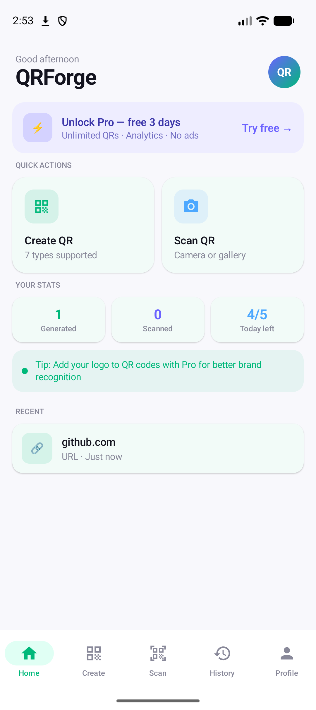
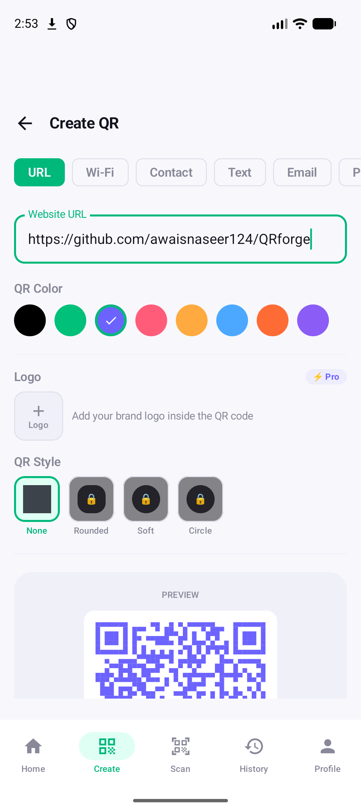
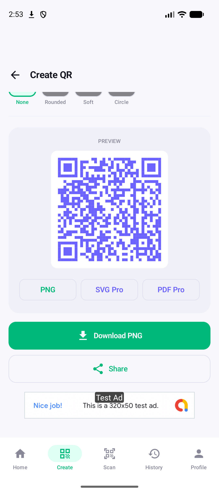
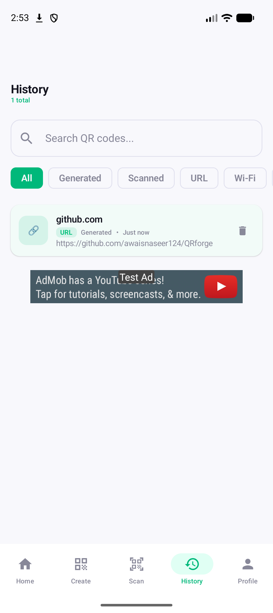
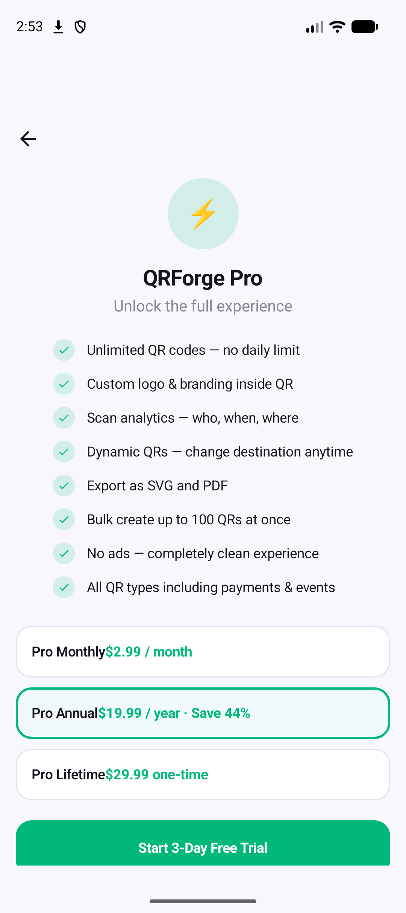

# QRForge

A modern QR code generator and scanner for Android, built with **Kotlin** and **Jetpack Compose**.

> 💼 **Portfolio project.** QRForge was built with the help of **[Claude](https://claude.ai) (Anthropic's AI assistant)**. I used Claude as a pair programmer for architecture, writing code, and debugging, and I directed the product, design decisions, and testing myself.

<p align="center">
  
  
  
  
  
</p>

## Features

**Generate**
- 7 QR types: URL, Wi-Fi, Contact (vCard), Text, Email, Phone, SMS
- Custom QR colors with a live preview
- Pro branding: add your logo inside the QR, plus rounded, soft, and circle styles
- Export as PNG (saved to `Pictures/QRForge`), or SVG and PDF on Pro
- Share straight from the app

**Scan**
- Live camera scanning with CameraX and ML Kit barcode detection
- Scan QR codes from gallery images

**Organize**
- History of generated and scanned codes, stored locally with Room
- Search and filter by type or source
- Home dashboard with stats, recent codes, and a daily usage limit

**Monetization (sample setup)**
- Google Play Billing: monthly, yearly, and lifetime Pro plans with a free trial
- AdMob banner, interstitial, and rewarded ads (uses Google's **test** ad unit IDs)

## Tech stack

| Area | Library |
|---|---|
| UI | Jetpack Compose, Material 3, Navigation Compose |
| Architecture | MVVM, Kotlin Coroutines / Flow |
| DI | Hilt |
| Storage | Room, DataStore |
| Camera & scanning | CameraX, ML Kit Barcode Scanning |
| QR generation | ZXing |
| Images | Coil |
| Services | Firebase (Analytics, Crashlytics, Messaging), AdMob, Play Billing |

## Project structure

```
app/src/main/java/com/qrforge/app/
├── core/
│   ├── ads/         # AdMob wrapper + banner composable
│   ├── billing/     # Play Billing + subscription state
│   ├── qr/          # QR generation, logo overlay, SVG/PDF/PNG export
│   └── scanner/     # CameraX analyzer + permission handling
├── data/            # Room database, DAO, repository
├── feature/         # Screens + ViewModels (home, generate, scanner, history, pro, profile)
├── navigation/      # NavGraph and routes
└── ui/theme/        # Colors, typography, shared components
```

## Getting started

**Requirements:** Android Studio (Koala or newer), JDK 17, Android SDK 35. The app's minimum SDK is 26.

1. Clone the repo:
   ```bash
   git clone https://github.com/awaisnaseer124/QRforge.git
   ```
2. Add your own Firebase config: create a Firebase project, download `google-services.json`, and place it in `app/`. The file is gitignored, so the build fails without it.
3. Open the project in Android Studio and run the `app` configuration.

> Pro features can be tested without a real purchase using the **Test Pro Mode** toggle on the Profile screen (a dev-only switch).

## Acknowledgements

Built with help from [Claude](https://claude.ai) by Anthropic.

## Author

**Awais Naseer** · [GitHub](https://github.com/awaisnaseer124)
